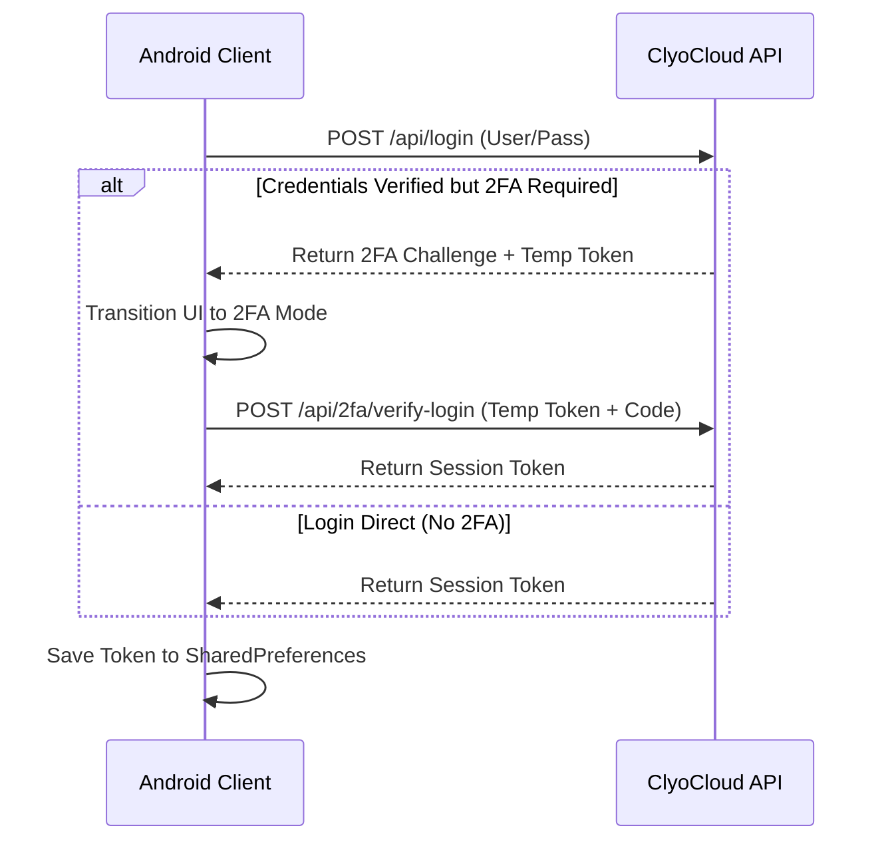

# Architecture & Design - ClyoCloudAndroid

This document explains the code organization, key models, and architectural patterns of ClyoCloudAndroid.

---

## 1. UI Layer & Custom Vector Icons

The UI is built exclusively using Jetpack Compose with a dark obsidian/amethyst theme.

*   **Themes**: Structured inside [ui/theme/Theme.kt](file:///home/weexnes/ClyoWallpaper/ClyoCloudAndroid/app/src/main/java/dev/weexnes/clyocloudandroid/ui/theme/Theme.kt) using a custom `MaterialTheme` configuration.
*   **Vector Icons**: To avoid the large binary footprint of the `material-icons-extended` Gradle dependency, custom vector paths (e.g. `GridViewIcon`, `ListViewIcon`, `UploadIcon`, `ShareIcon`) are dynamically defined in code utilizing the `ImageVector.Builder` API.
*   **Aesthetics**: Glassmorphism is achieved using composite alpha overlays, layered borders, and gradient backdrops:
    *   `GlassBackground`: Vertical gradient of obsidian and amethyst with offset radial blurs.
    *   `GlassCard`: Custom border gradient and light container alpha.
    *   `GlassTextField`: Material 3 OutlinedTextField with custom color states and rounded shapes.

---

## 2. Navigation & State Routing

Navigation flows are handled using simple state hoisting inside the `MainAppRouter` in [MainActivity.kt](file:///home/weexnes/ClyoWallpaper/ClyoCloudAndroid/app/src/main/java/dev/weexnes/clyocloudandroid/MainActivity.kt):

*   **`AppScreen` States**:
    *   `Login`: Handled by `LoginScreen` which verifies credentials and checks 2FA status.
    *   `Dashboard`: Handled by `DashboardScreen` which contains tabs for Files, Media, and Settings.
*   **Data Preservation**: Connection URLs and authentications are read/written on startup utilizing `PrefsManager`.

---

## 3. Network Communication & 2FA Flow

All server APIs are called using lightweight HTTP request routines powered by Kotlin Coroutines (`Dispatchers.IO`) without bulky third-party networking libraries.

### Authentication & 2FA State Machine

1.  **`loginToCloud`**: Sends credentials. If the server replies with a temporary token indicating 2FA is needed (`isPartial: true`), the UI transitions to 2FA mode.
2.  **`verify2fa`**: Submits the TOTP code along with the temporary token. On success, it retrieves the final session token and saves it via `PrefsManager`.
