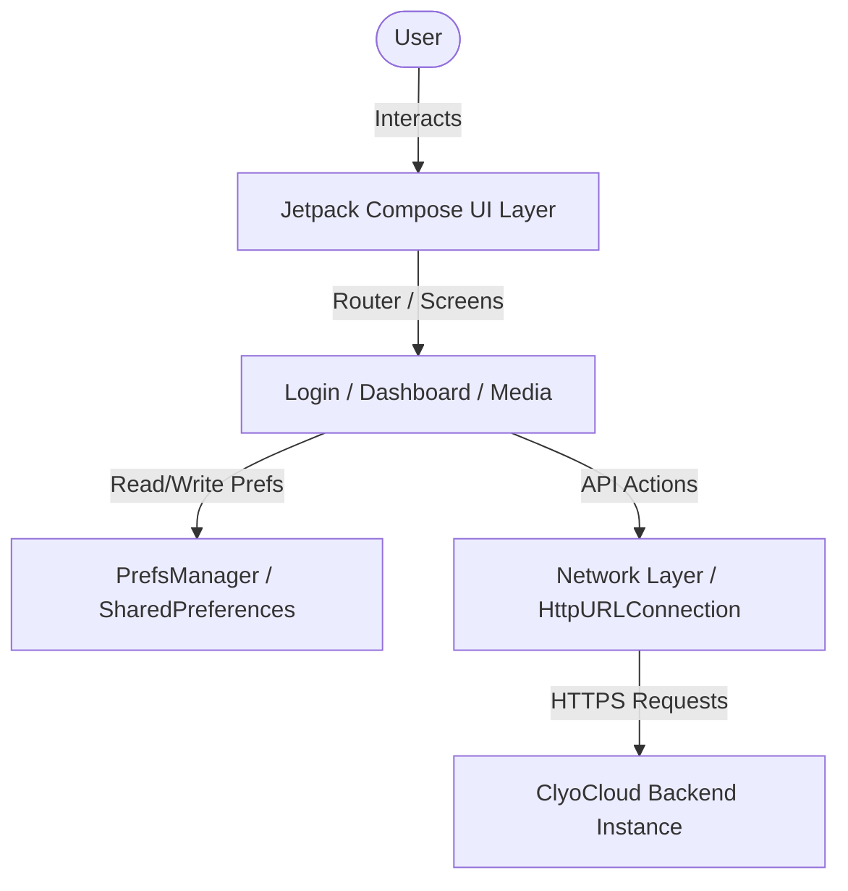

# 📱 ClyoCloudAndroid

<p align="center">
  
</p>

<p align="center">
  <strong>A premium, native Android companion application for ClyoCloud, built with Jetpack Compose and rich Glassmorphic aesthetics.</strong>
</p>

<p align="center">
  <a href="#features"></a>
  <a href="#technologies"></a>
  <a href="#getting-started"></a>
</p>

---

ClyoCloudAndroid brings your self-hosted **ClyoCloud** storage and media library directly to your mobile device. Emphasizing privacy, speed, and premium user experience, the app offers fully native performance, media playback, and metadata management wrapped in a modern glassmorphic interface.

---

## 🚀 Key Features

*   **🔒 Secure Connection & 2FA**: Connects securely to your self-hosted ClyoCloud instance. Fully supports the two-step TOTP 2FA verification flow with temporary token validation.
*   **📂 Native File Explorer**: Browse folders, view file metadata (size, last modified, tags, descriptions), and perform operations like file uploads and downloads.
*   **✨ Glassmorphic UI**: Beautiful obsidian and amethyst gradients with glowing backdrop radials, customizable glass cards, and unified custom vector icons.
*   **🎬 Media Center**: Streaming video playback using native `VideoView` and sliding slideshow previews for images.
*   **🏷 Metadata Editor**: Edit tags, description details, toggle public share status, and add items to your favorites directly from the mobile app.
*   **💾 Local Caching & Preferences**: Persists server connection states and credentials securely using `SharedPreferences`.

---

## 🛠 Tech Stack & Architecture

ClyoCloudAndroid is built using modern Android development practices:



| Layer | Technology | Purpose |
| :--- | :--- | :--- |
| **User Interface** | **Jetpack Compose**, **Material 3** | Declarative, premium, responsive UI featuring custom animations and glassmorphic designs. |
| **Programming Language** | **Kotlin** | Clean, concise, and asynchronous execution with Coroutines. |
| **Networking** | **HttpURLConnection** & **JSON Processing** | Lightweight, dependency-free HTTP communication with ClyoCloud REST API endpoints. |
| **Session Persistence** | **SharedPreferences** | Secure local storage of instance URLs, usernames, and authentication tokens. |

---

## 🏁 Getting Started

### 📋 Prerequisites

*   **Android Studio** (Koala or newer recommended)
*   **Android SDK** (API Level 24+ supported, API 34 target)
*   **ClyoCloud Server**: A running instance of ClyoCloud accessible over the network.

### 📦 Pre-built APKs

For automatically built APKs from the OneDev workflow, download the latest artifacts directly:
*   [Latest APK Artifacts](https://weexnes.dev/project/ClyoCloudAndroid#artifacts)

### 💻 Build & Install from Source

1.  **Clone the Repository** (if not already done):
    ```bash
    git clone <repository-url>
    cd ClyoCloudAndroid
    ```

2.  **Open in Android Studio**:
    *   Select **File > Open** and choose the `ClyoCloudAndroid` directory.
    *   Allow Gradle sync to download all required dependencies.

3.  **Build via CLI** (Optional):
    ```bash
    # Build debug APK
    ./gradlew assembleDebug
    ```

4.  **Run on Device/Emulator**:
    *   Select your target device in Android Studio and click **Run**.
    *   Enter your self-hosted ClyoCloud URL (e.g. `http://10.0.2.2:3000` for default emulator localhost, or your domain/IP).
    *   Log in using your ClyoCloud credentials.

## 📖 Documentation

Detailed architectural overviews, security specifications, and setups can be found in the project documentation:
*   [Introduction & Features Overview](https://weexnes.dev/project/ClyoCloudAndroid?path=introduction.md)
*   [Architecture & Design Details](https://weexnes.dev/project/ClyoCloudAndroid?path=architecture.md)
*   [Setup & Build Guide](https://weexnes.dev/project/ClyoCloudAndroid?path=setup-guide.md)