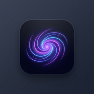

<div align="center">
  
  <h1>ClyoCloudAndroid</h1>
  <p>Android companion app for <a href="https://code.weexnes.dev/ClyoCloud">ClyoCloud</a>, built with Jetpack Compose.</p>
  <p>
    <a href="https://weexnes.dev/project/ClyoCloudAndroid#artifacts"></a>
    <a href="#requirements"></a>
    <a href="#tech-stack-and-architecture"></a>
  </p>
  <p>
    <a href="https://weexnes.dev/project/ClyoCloudAndroid#artifacts">Download</a> ·
    <a href="https://weexnes.dev/project/ClyoCloudAndroid?path=introduction.md">Docs</a>
  </p>
</div>

---

ClyoCloudAndroid brings your self-hosted ClyoCloud storage, media library and wallpapers to your phone. Since 1.3.0 it
also includes everything from the former **ClyoWallpaper** app, so one app does both. The interface follows the same
black, monochrome design as the web UI.

## Features

- **Sign-in:** server address, username and password, two-factor codes, or scanning the login QR code from the website.
- **Files:** browse with breadcrumbs, search by name or tag, sort, list or grid, upload in the background, new folders, and multi-select to download as ZIP, star, tag, rename, move or delete.
- **Details:** notes, tags (from your tag library or new ones), public links, wallpaper and photo-widget flags, and folder thumbnails.
- **Media:** the video and slideshow library with search, and a full-screen Shorts feed.
- **Viewer:** swipe through images and videos, pinch to zoom.
- **Wallpapers** (formerly ClyoWallpaper):
  - Library of everything marked as wallpaper, with a playlist.
  - Framing editor (pan and zoom per image, for home, lock or both).
  - Automatic changes every 15 minutes to 1 day, shuffled or in order, from all wallpapers or the playlist, optionally only on Wi-Fi. Runs on WorkManager, so it keeps going while the phone sleeps and after restarts, without a permanent notification.
  - **Create wallpaper:** extend and upscale any photo to 2880×1800 with the server's ComfyUI pipeline (scene preset, upscale model, custom prompts, live progress).
  - Home-screen widgets: current wallpaper with a countdown (tap to change), and a rotating photo widget.
- **Camera backup:** new photos and videos upload automatically shortly after they're taken (and hourly as a safety net). Choose albums, include videos or not, Wi-Fi only, only while charging, a target folder with Year/Month subfolders, and whether to start with new photos only or everything. Nothing is uploaded twice, and files with the same name never overwrite each other.
- **Save to ClyoCloud:** appears in every app's share menu. Pick a folder (recent ones first, or create one) and the files upload in the background; shared text is saved as a note.
- **Settings:** dark or light theme, camera backup, recycle bin, image cache, sign out.

## Requirements

- **A phone with Android 15 or newer** (minSdk 35)
- **ClyoCloud server** 2.21.0 or newer (for wallpaper generation and wallpaper sync), reachable from the phone

## Install

Download the APK built automatically by the OneDev workflow from
**[weexnes.dev/project/ClyoCloudAndroid](https://weexnes.dev/project/ClyoCloudAndroid#artifacts)**.

Open the app, enter your self-hosted ClyoCloud URL, and log in with your ClyoCloud credentials.

## Build from source

Prerequisites:

- **Android Studio**, or the Android SDK command-line tools with platform 35
- **JDK 21** for Gradle (17 to 25 work; newer JDKs are not supported by Gradle 9.1)

1. Clone the repository (if not already done):

   ```bash
   git clone <repository-url>
   cd ClyoCloudAndroid
   ```

2. Open it in Android Studio: **File > Open**, choose the `ClyoCloudAndroid` directory, and let Gradle sync download all dependencies.

3. Build from the command line (optional):

   ```bash
   # Build debug APK
   ./gradlew assembleDebug
   ```

4. Run on a device or emulator: select your target device in Android Studio and click **Run**. Enter your self-hosted ClyoCloud URL and log in with your ClyoCloud credentials.

### Tech stack and architecture

- Kotlin, Jetpack Compose and Material 3 (restyled with the ClyoCloud design tokens), Geist and Geist Mono fonts bundled.
- `HttpURLConnection` API client (`data/Api.kt`), downsampling image loader with memory and disk cache (`data/ImageLoader.kt`).
- WorkManager jobs for the wallpaper cycle and photo widget (`wallpaper/`), a foreground service for uploads, the system download manager for downloads.

## Project structure

```text
app/src/main/java/dev/weexnes/clyocloud/
├── MainActivity.kt          entry point
├── data/                    API client, models, session, image loading
├── ui/                      app state, navigation, theme, components, screens
└── wallpaper/               wallpaper cycle, applying/framing, widgets
```

## Docs

Detailed architectural overviews, security specifications and setup guides:

- [Introduction and features overview](https://weexnes.dev/project/ClyoCloudAndroid?path=introduction.md)
- [Architecture and design details](https://weexnes.dev/project/ClyoCloudAndroid?path=architecture.md)
- [Setup and build guide](https://weexnes.dev/project/ClyoCloudAndroid?path=setup-guide.md)

## License

No license has been chosen yet. The bundled Geist fonts are under the SIL Open Font License ([licenses/Geist-OFL.txt](licenses/Geist-OFL.txt)).
